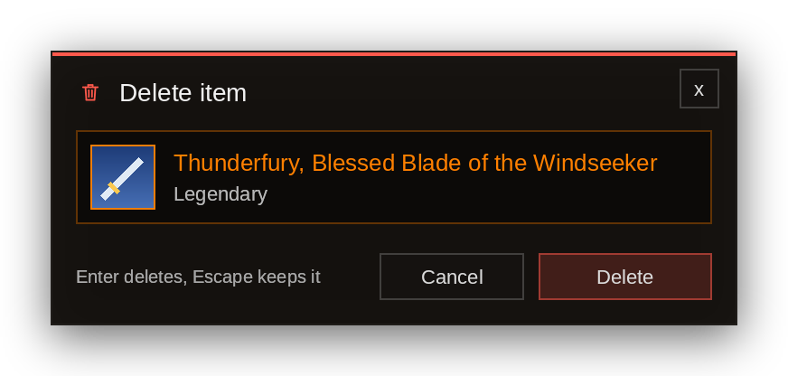

# Easy Delete

**Stop typing “DELETE”. Just click Delete.**

---

Deleting a valuable item in World of Warcraft makes you type the word **DELETE** into the confirmation box every time. Easy Delete replaces that popup with a clean dialog that shows exactly what you are about to destroy: its icon, name, quality and stack size. One click on **Delete**, or a press of **Enter**, and it's gone.

## Features

- **One click to delete.** No more typing “DELETE” for rare, epic or quest items. **Enter** deletes, **Escape** keeps the item.
- **See what you delete.** The item's icon, name in its quality colour, quality and stack size. Hover the item for its full tooltip.
- **Quest items are flagged.** A warning shows when deleting the item also abandons its quest.
- **A modern look.** Dark panels, thin borders and a red accent, matching Crescendo and EllesmereUI. With EllesmereUI installed, the dialog uses its font.
- **Every version of the game.** One download works on Retail, all Classic flavors and WoW Forever.
- **Zero setup.** Install it and it works. Prefer the game's own popup? Type `/easydelete classic`.

## Supported game versions

| Game version | Patch | TOC file |
| --- | --- | --- |
| Retail (Midnight) | 12.1.0 / 12.1.5 | `EasyDelete.toc` |
| WoW Forever | 1.60.1 | `EasyDelete_Camelot.toc` |
| Mists of Pandaria Classic | 5.5.4 | `EasyDelete_Mists.toc` |
| Wrath of the Lich King Classic / Titan | 3.4.5 / 3.80.2 | `EasyDelete_Wrath.toc` |
| Burning Crusade Anniversary | 2.5.6 | `EasyDelete_TBC.toc` |
| Classic Era | 1.15.9 | `EasyDelete_Vanilla.toc` |

The game automatically loads the right `.toc` file for the client you are playing on.

## Installation

**With the CurseForge app (recommended):** search for **Easy Delete** and click *Install*. Updates arrive automatically.

**Manually:**

1. Download the latest `EasyDelete-vX.Y.zip` from [CurseForge](https://www.curseforge.com/wow/addons/easy-delete/files) or [GitHub Releases](https://github.com/xibate/EasyDelete/releases/latest).
2. Extract it into your AddOns folder, for example:
   - `World of Warcraft\_retail_\Interface\AddOns\`
   - `World of Warcraft\_classic_era_\Interface\AddOns\`
3. You should end up with `Interface\AddOns\EasyDelete\EasyDelete.toc`.
4. Restart the game or type `/reload`.

## Commands

| Command | What it does |
| --- | --- |
| `/easydelete` | Shows which dialog is in use and the commands. `/edel` works too. |
| `/easydelete preview` | Shows the dialog with an example item, without deleting anything. |
| `/easydelete classic` | Uses the game's own popup instead, with “DELETE” already filled in. |
| `/easydelete dialog` | Goes back to Easy Delete's dialog. |

## How it works

When you drag an item out of your bags to destroy it, the game opens its confirmation popup. Easy Delete closes that popup straight away and shows its own dialog for the item on your cursor:

- **Delete** or **Enter** destroys the item.
- **Cancel**, **x** or **Escape** puts it back where it came from.
- If the item leaves your cursor some other way, the dialog closes by itself.

The game restricts what addons can do in combat, so to be safe Easy Delete uses the game's popup in combat with “DELETE” already filled in, and **Yes** works right away. If a fight starts while the dialog is open, the item goes back to your bags.

The item is only ever deleted when you click **Delete** or press **Enter** yourself.

## Credits

Made by **Xibate** and **Zynx**.

Found a bug or have an idea? [Open an issue](https://github.com/xibate/EasyDelete/issues).
